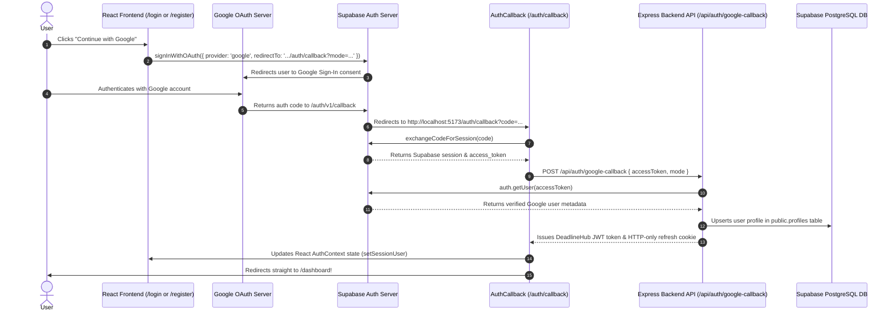

# 🔑 Google OAuth 2.0 & Supabase Integration Guide for DeadlineHub

This step-by-step guide explains how to set up, configure, and integrate Google OAuth 2.0 authentication with Supabase and the Express backend for **DeadlineHub**.

---

## 📑 Table of Contents
- [1. Google Cloud Console Setup](#1-google-cloud-console-setup)
- [2. Supabase Authentication Provider Setup](#2-supabase-authentication-provider-setup)
- [3. Supabase URL & Redirect Configuration](#3-supabase-url--redirect-configuration)
- [4. Database Trigger & RLS Setup](#4-database-trigger--rls-setup)
- [5. How the DeadlineHub OAuth Architecture Works](#5-how-the-deadlinehub-oauth-architecture-works)
- [6. Troubleshooting Common Issues](#6-troubleshooting-common-issues)

---

## 1. Google Cloud Console Setup

### Step 1: Create a Google Cloud Project
1. Navigate to the [Google Cloud Console](https://console.cloud.google.com/).
2. Click the project dropdown at the top navigation bar and select **New Project**.
3. Enter Project Name: `DeadlineHub` (or your preferred name) and click **Create**.

### Step 2: Configure OAuth Consent Screen
1. In the left navigation menu, go to **APIs & Services** $\rightarrow$ **OAuth consent screen**.
2. Select **External** user type and click **Create**.
3. Fill in the required App Information:
   - **App name**: `DeadlineHub`
   - **User support email**: *Your email address*
   - **Developer contact information**: *Your email address*
4. Click **Save and Continue**.
5. Under **Scopes**, click **Add or Remove Scopes** and select:
   - `.../auth/userinfo.email`
   - `.../auth/userinfo.profile`
   - `openid`
6. Click **Save and Continue**.
7. (Optional) Under **Test users**, add your Google email address for testing while in testing mode. Click **Save and Continue**.

### Step 3: Create OAuth 2.0 Credentials
1. In the left menu, go to **APIs & Services** $\rightarrow$ **Credentials**.
2. Click **+ Create Credentials** $\rightarrow$ **OAuth client ID**.
3. Select **Application type**: `Web application`.
4. Set **Name**: `DeadlineHub Web Client`.
5. Under **Authorized JavaScript origins**, add:
   - `http://localhost:5173`
   - `http://127.0.0.1:5173`
   - `https://deadlinehub-online.vercel.app` *(Your production domain)*
6. Under **Authorized redirect URIs**, add your Supabase Auth Callback URL:
   - `https://<YOUR-SUPABASE-PROJECT-ID>.supabase.co/auth/v1/callback`
   *(Example: `https://aghilcdqtreiztnzvoqr.supabase.co/auth/v1/callback`)*
7. Click **Create**.
8. Copy your **Client ID** and **Client Secret** (store them safely; you will paste them into Supabase).

---

## 2. Supabase Authentication Provider Setup

1. Open your [Supabase Dashboard](https://supabase.com/dashboard) and select your project.
2. In the left menu, navigate to **Authentication** $\rightarrow$ **Providers**.
3. Find **Google** in the provider list and click to expand it.
4. Toggle **Enable Google Provider** to **ON**.
5. Paste your credentials:
   - **Client ID**: Paste from Google Cloud Console.
   - **Client Secret**: Paste from Google Cloud Console *(Ensure no trailing or leading whitespace)*.
6. Copy the displayed **Callback URL (for Google OAuth)**:
   - `https://<YOUR-PROJECT-ID>.supabase.co/auth/v1/callback`
   *(Confirm this matches what you pasted in Google Cloud Console credentials!)*
7. Click **Save**.

---

## 3. Supabase URL & Redirect Configuration

1. In Supabase Dashboard, go to **Authentication** $\rightarrow$ **URL Configuration**.
2. Set **Site URL**:
   - `http://localhost:5173` *(Local development)*
3. Add **Redirect URLs**:
   - `http://localhost:5173/auth/callback`
   - `https://deadlinehub-online.vercel.app/auth/callback`
4. Click **Save**.

---

## 4. Database Trigger & RLS Setup

When a user signs up via Google OAuth, Supabase automatically creates an authentication record in `auth.users`. 

The required database tables, RLS policies, and PostgreSQL triggers are already included in the [`database/schema.sql`](../database/schema.sql) file.

### Steps:
1. Open [`database/schema.sql`](../database/schema.sql) in your code editor or GitHub repository.
2. Copy its contents.
3. Open **Supabase Dashboard** $\rightarrow$ **SQL Editor** $\rightarrow$ **New Query**.
4. Paste the schema contents and click **Run**.

This automatically sets up:
- The `profiles` table to store Google user profiles.
- The `handle_new_user()` trigger to automatically create user profiles upon Google OAuth sign-up.
- Row-Level Security (RLS) policies allowing secure profile reading, insertion, and updates.

---

## 5. How the DeadlineHub OAuth Architecture Works

### Key Workflow Principles:
1. **Single-Attempt Instant Redirection**: When Google finishes authentication, `AuthCallback.tsx` calls `setSessionUser` to populate React AuthContext state before calling `navigate('/dashboard')`, preventing unwanted redirects back to `/login`.
2. **Duplicate Registration Check**:
   - If a user tries to click **"Continue with Google"** on the **Register page** (`mode=signup`), but their Google account already existed in DeadlineHub, the backend detects this and displays:
     > 🔴 *"An account is already registered under this email. Please sign in instead."*
   - On the **Login page** (`mode=login`), existing Google users are signed in directly to their dashboard.

---

## 6. Troubleshooting Common Issues

| Error Message / Symptom | Possible Cause | Resolution |
|---|---|---|
| `redirect_uri_mismatch` | Google Cloud Authorized Redirect URI does not match Supabase | Add `https://<PROJECT-ID>.supabase.co/auth/v1/callback` under OAuth Credentials in Google Cloud Console. |
| `Unable to exchange external code` | Client Secret mismatch or code expired (>60s) | Re-copy Client Secret from Google Cloud Console to Supabase Google Provider settings. Ensure no spaces. |
| `Database error saving new user` | Postgres trigger exception during signup | Run the bulletproof SQL snippet in Section 4 in Supabase SQL Editor. |
| `new row violates row-level security policy` | Profiles RLS blocking API insert/update | Run Section 4 SQL script to grant INSERT/UPDATE permissions to the profiles table. |
| Redirected to Login on 1st try | React auth state not updated before routing | Handled automatically by DeadlineHub's `setSessionUser` context method. |

---

Developed for **[DeadlineHub](https://github.com/nischal1sir/DeadlineHub)**.
